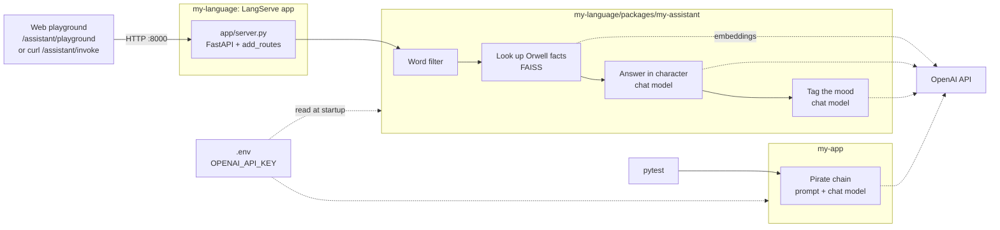

# Hands-on  langchain

[](https://www.python.org/)
[](https://python.langchain.com/)
[](https://github.com/langchain-ai/langserve)
[](https://smith.langchain.com/)
[](https://platform.openai.com/docs/models)
[](https://github.com/facebookresearch/faiss)
[](https://fastapi.tiangolo.com/)
[](https://www.uvicorn.org/)
[](https://docs.pydantic.dev/)
[](https://python-poetry.org/)
[](https://www.docker.com/)

## Quick start

Runs the **my-language** demo: a LangServe REST API with a chat playground where you talk to a character from a book or play (Mark Anthony from *Julius Caesar* by default), backed by a small George Orwell knowledge base.

Needs Python 3.11+, internet access and an OpenAI API key. You don't need Poetry installed; `run.sh` sets it up.

```bash
git clone https://github.com/ibipul/lang_chain_playground.git
cd lang_chain_playground
```

> [!IMPORTANT]
> **Add your OpenAI API key before the first run.** The repo doesn't include one.
>
> 1. Create a key at https://platform.openai.com/api-keys (the API needs credits on your OpenAI account).
> 2. Copy the template: `cp .env.example .env`
> 3. Open `.env` and replace `PASTE_YOUR_OPENAI_KEY_HERE` with your key:
>    ```
>    OPENAI_API_KEY=sk-...your-key...
>    ```
>
> `.env` is listed in `.gitignore`, so git won't commit your key. Don't put the key in `.env.example` or anywhere else that's tracked. LangSmith tracing is optional; fill in the `LANGSMITH_*` lines in `.env` to turn it on.

Then start the app:

```bash
./run.sh
```

`run.sh` walks through five numbered steps: check Python, install Poetry and the packages (first run only, into `.poetry` and `.venv`), check the API key with OpenAI, find a free port, start the server. When it prints **● Ready: http://localhost:8000/assistant/playground/** it opens the chat playground in your browser. Keep that terminal open; press Ctrl+C there to stop.

Other ways to use it while it runs:
- API docs: http://localhost:8000/docs
- Call it from the terminal with the `curl` example in [my-language](#my-language) below.
- `PORT=9000 ./run.sh` uses a fixed port. `NO_BROWSER=1 ./run.sh` skips opening the browser.

<details>
<summary><b>Quick Troubleshooting</b> (click to show)</summary>

| You see | What it means / what to do |
|---|---|
| `Python 3.11 or newer is required` | Install Python 3.11+, or point to one: `PYTHON=/path/to/python3.11 ./run.sh` |
| `Missing .env` / `No API key in .env` | Do the key steps in the box above. |
| `OpenAI rejected the key (HTTP 401)` | The key is wrong or was deleted. Create a new one and paste it into `.env`. |
| `Package install failed` | Usually a network problem. Run `./run.sh` again; if it keeps failing, delete `.venv` and retry. |
| `The server stopped during startup` | Read the error above it. A `429` / `insufficient_quota` error means your OpenAI account has no credits left. |
| `An earlier run of this app is already serving ...` | It's already running; use that URL, or stop it first. |

</details>

## How the repo fits together

The repo holds three small Python projects. They share one set of locked versions and run from one virtual environment, `.venv`, at the repo root.

- **`my-language/`** ([README](my-language/README.md)): the web server. It's a [LangServe](https://github.com/langchain-ai/langserve) app (FastAPI underneath) that publishes the assistant under `/assistant`. This is what `./run.sh` starts. Once it's running you get:
  - **http://localhost:8000/assistant/playground/**: an interactive web interface for the assistant. Type a question, optionally change the character, title and personality, and read the in-character reply with its mood tag. `./run.sh` opens this page for you.
  - **`/assistant/invoke`** and **`/assistant/stream`**: the REST API behind it, for `curl` or your own code (example under [my-language](#my-language)).
  - **http://localhost:8000/docs**: API docs listing every endpoint.
- **`my-language/packages/my-assistant/`** ([README](my-language/packages/my-assistant/README.md)): the chain that server publishes, the Mark Anthony role-play assistant. For each question it:
  1. blocks a short list of swear words
  2. looks up related lines in `orwell_facts.txt` (a small FAISS vector store built with OpenAI embeddings when the server starts)
  3. asks the chat model to answer in character, using those lines as context
  4. asks the model a second time to name the reply's mood, and appends `[Mood: …]`
- **`my-app/`** ([README](my-app/README.md)): the first demo, an even smaller chain (a prompt and a model) that answers like a pirate. Its idea of giving the model a character grew into `my-assistant`. Nothing serves it; you run it through its test.



Each chain (`my-assistant`, `my-app`) is a normal Python package with its own `pyproject.toml`, listing the libraries it imports. The **root `pyproject.toml`** sets the shared versions, adds the server and dev tools, and installs every chain from its folder in editable mode: Python uses the code in the folders directly, so your edits apply without reinstalling. **One `poetry.lock`**, at the root, picks one exact version of everything (managed with [Poetry](https://python-poetry.org/)). See [Dependencies](#dependencies) for the rules that keep it consistent.

## Project notes

### my-app
A simple prompt|model response chain
 - `langchain template new my-app` 
 - needs OpenAI api key (get your own)
 - installed into the shared `.venv` by `./run.sh --install` (see [Development](#development))

### my-language
Setup a REST API with langchain serve. It serves a RAG based assistant, which roleplays any character from any book/play, with a personality cue, and has an context of George Orwell. It can say pessimistic stuff, if you ask it to!
 - `langchain app new my-language --package $PWD/my-assistant` 
 - `add_routes(app, my_app_chain, path="/assistant")`
 - installed into the shared `.venv` by `./run.sh` or `./run.sh --install`
 -  `cd my-language; langchain serve`
 - `http://127.0.0.1:8000/docs` to see all the API endpoints
 - `http://127.0.0.1:8000/assistant/playground` to get a default chat interface
 - interacting with the playground chat box UI, it will invoke the `stream` endpoint
 - if `curl` is used then it uses the `invoke` endpoint
 ```
 curl --location --request POST 'http://127.0.0.1:8000/assistant/invoke' \
--header 'Content-Type: application/json' \
--data-raw '{
    "input": {
        "question": "Hello, Anthony does the world feel like it is against you?",
        "character": "Mark Anthony",
        "title": "Julius Caesar",
        "personality": "sullen mood, rhetorical, sarcastic, and dramatic"
    }
}'
```
Reponse:
```
Oh, how astute of you to notice! Indeed, it feels as though the very world conspires against me, drowning me in a sea of treachery and deceit. The nightmare of statistics haunts my every step, twisting reality into a cruel game of numbers. But fear not, for I shall rise above this adversity with the fire of vengeance burning in my heart!

[Mood: Defiant]
```

## Development

`./run.sh` is all you need to try the demo. This section is for working on the code: editing the chains, running tests, adding packages or new chains, or starting the server by hand.

### Setup

```bash
cp .env.example .env        # then add your OPENAI_API_KEY (see Quick start)
./run.sh --install
```

`./run.sh --install` installs Poetry into `.poetry`, then everything in the root `pyproject.toml`, including the dev tools (`langchain-cli`, `pytest`), into `.venv`. It also links `poetry` into `.venv/bin`, then exits without starting the server.

Then, in each new terminal, activate the venv from the repo root:

```bash
source .venv/bin/activate
```

That puts the project's `python`, `poetry`, `langchain` and `pytest` first on your PATH. Your key doesn't need exporting: the chains read `.env` from the repo root when they load. A variable already set in your shell takes precedence over `.env`.

### Everyday commands

With the venv active, from the repo root:

```bash
cd my-language && langchain serve                # http://127.0.0.1:8000/assistant/playground/  (Ctrl+C to stop)
cd my-language/packages/my-assistant && pytest   # calls OpenAI once with the Mark Anthony question
cd my-app && pytest                              # calls OpenAI once with the pirate chain
```

`langchain serve` watches `my-language/` (which includes `packages/`) and reloads when you save a file, so edits to a chain take effect without a restart.

### Dependencies

The repo is laid out like a standard Python monorepo:

| File | Says |
|---|---|
| Root `pyproject.toml` | The shared versions (LangChain stack, Pydantic), the web server, the dev tools, and the list of chain packages to install from their folders |
| Each chain's `pyproject.toml` (e.g. `my-language/packages/my-assistant/pyproject.toml`) | The package's name and the libraries it imports, as wide version ranges such as `langchain-core>=1.0,<2`, so the package could be installed in any project |
| Root `poetry.lock` | The one exact version of every library, chosen to satisfy all of the above together |

Main versions today: LangChain 1.4.6, langchain-core 1.6.12, langchain-openai 1.7.2, langchain-community 0.4.2, LangSmith 0.14.11, LangServe 0.3.3, FastAPI 0.156.6, Uvicorn 0.54.0, Pydantic 2.14.1.

**Three rules keep it consistent:**

1. **One lock file, at the root.** A chain folder never gets its own `poetry.lock`. If it has one (for example in a package you copied in), Poetry ignores it; delete it.
2. **Run Poetry only from the repo root.** Never `poetry install`, `poetry add` or `poetry lock` inside a chain folder; that would create a second lock.
3. **Every chain is a normal package** with its own `pyproject.toml`, registered in the root with `poetry add --editable ./<folder>`.

If two packages ask for versions that can't both be met, `poetry lock` stops with an error naming the library, instead of installing two versions. `./run.sh` checks rules 1 and 3 every time it runs: it warns about stray lock files, and stops if a chain's dependency list changed without re-locking (Poetry itself only notices changes to the root `pyproject.toml`).

With the venv active, from the repo root:

| To | Do |
|---|---|
| Add a library one chain imports | Add it to that chain's `dependencies` list (a wide range, e.g. `"httpx>=0.27,<1"`), then `poetry lock && poetry install` |
| Add a library the server or several chains share | `poetry add <package>` (goes in the root `pyproject.toml`) |
| Add a dev-only tool | `poetry add --group dev <package>` |
| Remove a library | Delete it from the chain's list, or `poetry remove <package>` for the root; then `poetry lock && poetry install` |
| Upgrade within the allowed versions | `poetry update` (or `poetry update <package>`) |
| Move the shared stack to a newer version | Edit its line in the root `pyproject.toml`, then `poetry lock && poetry install`. Widen a chain's range only if the new version falls outside it. |

Commit the changed `pyproject.toml` files and `poetry.lock` together. `./run.sh` reinstalls by itself whenever `poetry.lock` changes, so after a `git pull` it picks up others' changes.

### Add your own chain

To add a chain (an app) next to `my-assistant`, serve it from `my-language`, and see which files to update, follow the step-by-step guide in [my-language/README.md](my-language/README.md#add-your-own-chain).

### Run in Docker

The `Dockerfile` at the repo root builds the LangServe app. Keys are passed at run time and never copied into the image (`.dockerignore` excludes `.env`):

```bash
docker build -t lang-chain-playground .
docker run --env-file .env -p 8080:8080 lang-chain-playground
```

Then open http://localhost:8080/assistant/playground/.

### Keep your key out of git

`.env` is in `.gitignore` and must never be committed. Only the template, `.env.example`, is tracked, and it holds no key. Put your key only in `.env`.

### Troubleshooting

| You see | What to do |
|---|---|
| `poetry: command not found` / `langchain: command not found` | Activate the venv: `source .venv/bin/activate`. If `.venv` doesn't exist yet, run `./run.sh --install`. |
| `OpenAIError: Missing credentials` | `.env` is missing or has no `OPENAI_API_KEY`. See the key box in Quick start. |
| `ModuleNotFoundError` for your new chain | It isn't registered yet: `poetry add --editable ./<chain folder>` from the repo root. |
| `pyproject.toml changed significantly since poetry.lock was last generated` | Someone edited the root `pyproject.toml` without re-locking. Run `poetry lock && poetry install`. |
| `poetry.lock is out of date` from `./run.sh` | A chain's `pyproject.toml` lists a library the lock doesn't have (the line above it names both). Run `.poetry/bin/poetry lock` from the repo root, then `./run.sh` again. |
| `poetry lock` fails: `... depends on X (...), version solving failed` | Two packages ask for versions of `X` that can't both be met. Widen one package's range, or move the shared version in the root `pyproject.toml`. |
